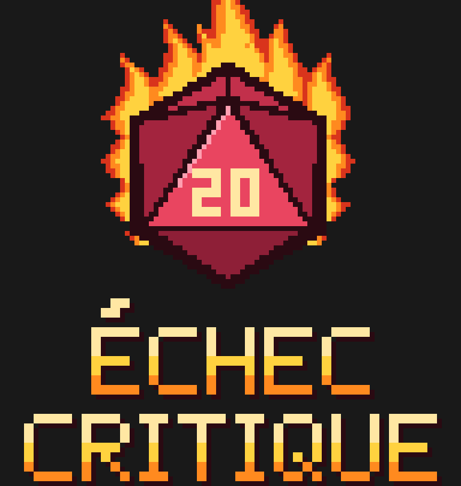

<p align="center">
  <a href="https://github.com/asyyy/echec-critique/actions/workflows/ci.yml"></a>
  
</p>

<p align="center">
  <a href="#english">🇬🇧 English</a> &nbsp;·&nbsp; <a href="#francais">🇫🇷 Français</a>
</p>

<a id="english"></a>

# Échec Critique



TODO Décrire le truc en anglais

© 2026 Alexys Guerin — licensed under [PolyForm Strict 1.0.0](./LICENSE): you may read the code and use the app for free for noncommercial purposes (for example at your table), but not modify or redistribute it. For any other use, ask me. The logo and icons are covered by the same license.

Not affiliated with Wizards of the Coast. D&D and related terms belong to their respective owners.

## A personal project

Échec Critique is my app, one I love building in my free time. I want to remain the only one working on it: I don't accept code contributions (pull requests). Feedback, ideas and bug reports are welcome in the issues.

## Use the app

- **Web, iPhone, PC**: open [asyyy.github.io/echec-critique](https://asyyy.github.io/echec-critique/) and install it from your browser (*Add to Home Screen*). It works offline once installed.
- **Android**: download the APK from the [Releases](https://github.com/asyyy/echec-critique/releases) page.

## Run locally

```bash
npm install
npm run dev
```

---

<a id="francais"></a>

# Échec Critique (Français)


TODO Écrire la description plus proprement : 
app pwa fait initialement pour mes joueurs trop idiots mais qui a pris un peu d'ampleur donc je me suis dit que je pouvais voir pour la partager (mais pas trop non plus), NE REMPLACE PAS LE D20, jamais je ne mettrais un lanceur de dé, c'est surtout pour facilité le suivi des stats, objets, et calcul de dégat a très haut niveau, récap de stats, buff/débuf temporaire, Pré configuration d'attaques (), 
J'ai encore pleins d'idée de trucs a rajouté aussi inutile que marrante, ça dépendra aussi des retours de mes joueurs 
Une version avec connexion pour échanger avec d'autres joueurs. (ça va prendre un peu de temps a mettre en place) (et des features permettant de fluidifier la session ainsi que des features plus marrante)


© 2026 Alexys Guerin — sous licence [PolyForm Strict 1.0.0](./LICENSE) : tu peux lire le code et utiliser l'app gratuitement à des fins non commerciales (par exemple à ta table), mais pas la modifier ni la redistribuer. Pour tout autre usage, demande-moi. Le logo et les icônes sont couverts par la même licence.

Non affilié à Wizards of the Coast. D&D et termes associés appartiennent à leurs propriétaires.

## Un projet perso

Échec Critique, c'est mon app, que j'aime développer sur mon temps libre. Je tiens à rester le seul à travailler dessus : je n'accepte pas de contributions de code (pull requests). Les retours, idées et signalements de bugs sont les bienvenus dans les issues.

## Utiliser l'app

- **Web, iPhone, PC** : ouvre [asyyy.github.io/echec-critique](https://asyyy.github.io/echec-critique/) et installe-la depuis ton navigateur (*Ajouter à l'écran d'accueil*). Elle fonctionne hors ligne une fois installée.
- **Android** : télécharge l'APK depuis la page [Releases](https://github.com/asyyy/echec-critique/releases).

## Lancer en local

```bash
npm install
npm run dev
```
